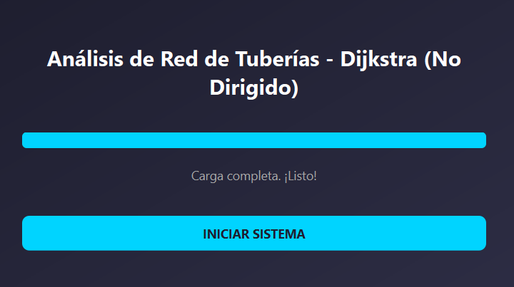
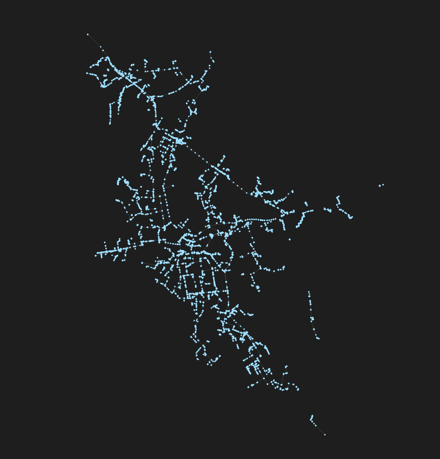
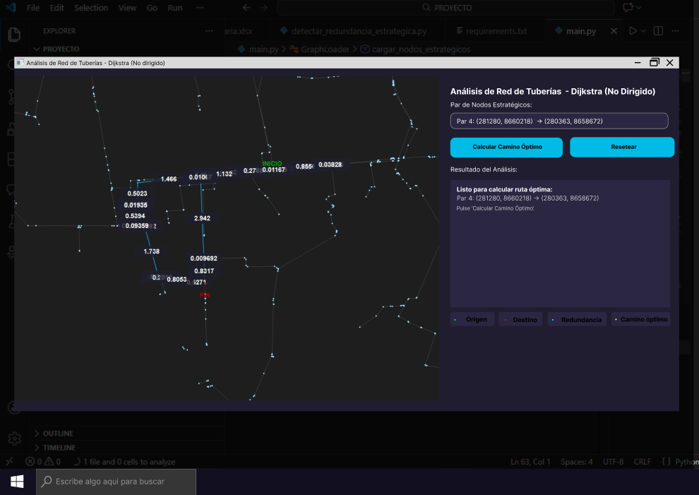
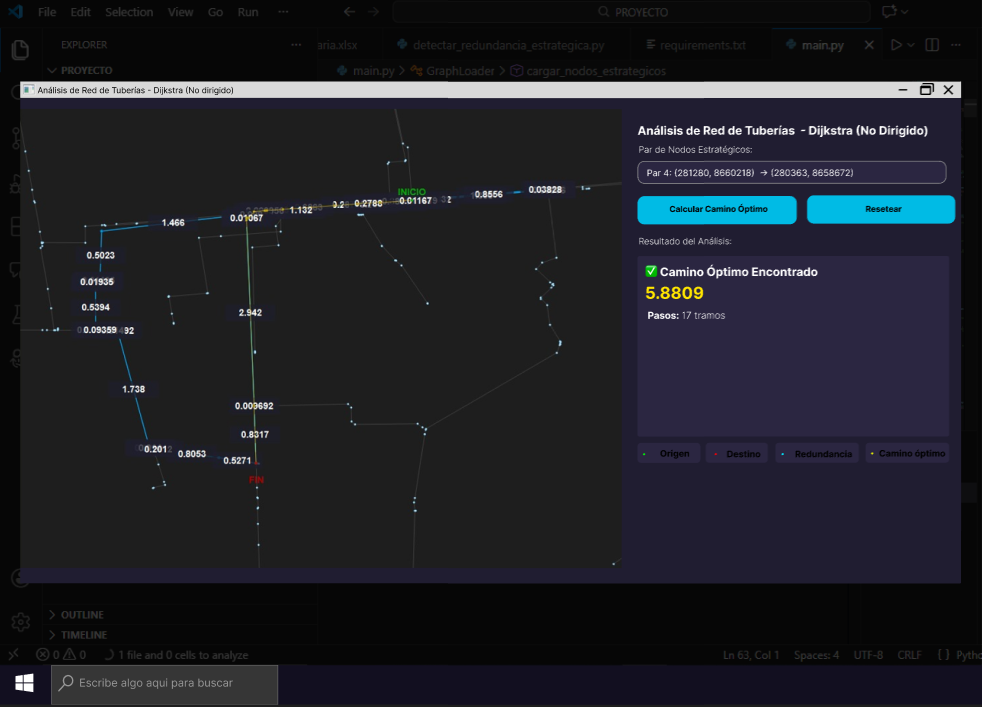

# Análisis de Red de Tuberías - Dijkstra

Este proyecto es una herramienta interactiva desarrollada en Python para el análisis y optimización de rutas en una red de tuberías. Utiliza el algoritmo de Dijkstra para calcular el camino más corto (o de menor costo) entre nodos estratégicos de la red, visualizando los resultados en una interfaz gráfica intuitiva.

## 👥 Integrantes
* Alvaro Alberto Neyra Salazar
* Carlos Marcelo Mansilla Rivero
* Salvador Arturo Díaz Miñano

## 📋 Descripción

La aplicación permite cargar un grafo de tuberías desde archivos Excel, visualizar la red completa, seleccionar pares de nodos estratégicos (origen y destino) y calcular la ruta óptima entre ellos. Es ideal para identificar redundancias y planificar rutas eficientes en infraestructuras de tuberías.

## ✨ Características Principales

*   **Visualización de Grafos**: Representación gráfica de nodos y aristas con soporte para Zoom y Pan (desplazamiento).
*   **Algoritmo de Dijkstra**: Cálculo preciso del camino mínimo entre dos puntos.
*   **Pares Estratégicos**: Carga y selección de pares de nodos predefinidos con información de redundancia.
*   **Interfaz Interactiva**: UI moderna construida con PyQt6, incluyendo pantalla de carga y panel de control.
*   **Análisis de Resultados**: Muestra el costo total y el número de tramos del camino óptimo.

## 📸 Capturas de Pantalla

### Pantalla de Inicio
La aplicación inicia con una pantalla de carga que prepara los componentes y datos del grafo.



### Visualización del Grafo
Vista general de la red de tuberías cargada. Se pueden observar los nodos y las conexiones.



### Selección de Pares Estratégicos
El usuario puede seleccionar un par de nodos (Origen -> Destino) desde un menú desplegable. Los nodos seleccionados se resaltan en el grafo.



### Camino Óptimo Encontrado
Una vez calculado, el sistema resalta la ruta óptima en color dorado y muestra los detalles del costo y tramos en el panel lateral.



## 🛠️ Instalación y Requisitos

Este proyecto requiere **Python 3.8+**.

1.  **Clonar el repositorio** (o descargar los archivos):
    Asegúrate de tener todos los archivos `.py` y los archivos de datos `.xlsx` en la misma carpeta.

2.  **Configurar el Entorno Virtual** (Opcional pero recomendado):
    Para mantener ordenadas las librerías, crea y activa un entorno llamado `complejidad_algoritmica`:

    ```bash
    # Crear el entorno virtual
    python -m venv complejidad_algoritmica

    # Activar el entorno (Windows)
    .\complejidad_algoritmica\Scripts\activate

    # Activar el entorno (macOS/Linux)
    source complejidad_algoritmica/bin/activate
    ```

3.  **Instalar dependencias**:
    Una vez activado el entorno, ejecuta el siguiente comando para instalar las librerías necesarias:

    ```bash
    pip install -r requirements.txt
    ```

    *Las principales dependencias son:*
    *   `PyQt6`: Para la interfaz gráfica.
    *   `pandas`: Para la manipulación de datos Excel.
    *   `openpyxl`: Motor para leer archivos Excel.
    *   `networkx` (opcional, si se usa en módulos auxiliares).

## 🚀 Uso

Para iniciar la aplicación, ejecuta el archivo `main.py`:

```bash
python main.py
```

1.  Espera a que finalice la pantalla de carga y presiona "INICIAR SISTEMA".
2.  En la ventana principal, usa el menú desplegable "Par de Nodos Estratégicos" para elegir una ruta a analizar.
3.  Haz clic en el botón **"Calcular Camino Óptimo"**.
4.  Observa el resultado en el grafo y en el panel de "Resultado del Análisis".
5.  Usa la rueda del ratón para hacer Zoom y arrastra con el clic izquierdo para moverte por el mapa.

## 📂 Estructura del Proyecto

*   `main.py`: Código principal de la aplicación (Interfaz y Lógica).
*   `Aristas_Grafo_Dijkstra_Final.xlsx`: Datos de las conexiones (aristas) de la red.
*   `Top_Pares_Redundancia_Detallada.xlsx`: Datos de los pares de nodos estratégicos.
*   `images/`: Carpeta con los recursos gráficos para este README.
